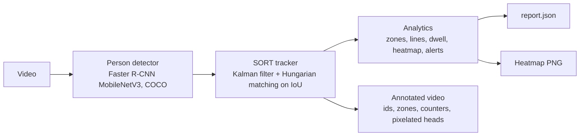
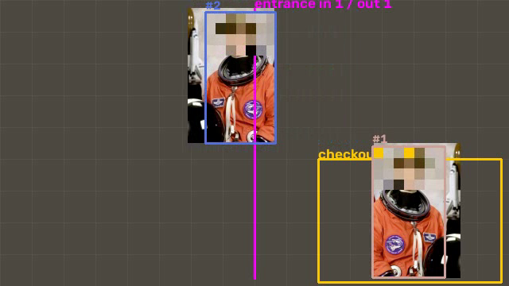

# Zone Occupancy & Line-Crossing Analytics

Turns ordinary camera footage into foot-traffic analytics:
- **who entered and left** through a doorway, with direction
- **how many people are in each zone**, with peak and average occupancy
- **how long they stayed** (dwell time)
- **when a zone exceeded its capacity** (alerts)
- a **heatmap** of where people stood

Privacy is built in: heads are pixelated in the output video, and uploaded footage is deleted as soon as it's processed.

> Built on 22 Nov 2026 for the 21 Nov slot of the daily project challenge. The calendar planned a PPE (hard-hat) detector, which needs a custom-trained model and labelled PPE data. Getting those means a paid or keyed data source, GPU training, or AGPL-licensed YOLO weights, so this related, fully open computer-vision product was built instead.

## How it works



| Stage | Details |
|---|---|
| Detection | torchvision `fasterrcnn_mobilenet_v3_large_fpn` pretrained on COCO (BSD-3), filtered to the `person` class with a score threshold and minimum box area. `--detect-every N` runs it every N frames and lets the tracker predict in between |
| Tracking | Implemented from scratch in the style of SORT: a 7-state constant-velocity Kalman filter per track, the Hungarian algorithm (`scipy.optimize.linear_sum_assignment`) on an IoU cost matrix, tentative tracks confirmed after `min_hits`, and lost tracks kept for `max_misses` frames so IDs survive short occlusions |
| Position | Each person's **foot point** (bottom-centre of the box), which is where they actually stand on the floor plane, not the box centre |
| Line counting | Segment–segment intersection between a track's previous and current foot point and the counting line. The direction comes from the sign of the cross product. A 1-second debounce stops a person jittering on the line from being counted repeatedly |
| Zones | Ray-casting point-in-polygon (concave polygons supported); per-zone occupancy series, peak/average, unique visitors, dwell per person, and seconds over capacity with one alert per episode |
| Privacy | The top third of each person box is pixelated in the output. Raw uploads are deleted after processing; only annotated output is kept |

## Results on footage with known ground truth

`occupancy demo out/` renders synthetic footage. Two "people" (the public-domain NASA astronaut photo bundled with scikit-image) cross the entrance in opposite directions, and one ends up standing in the checkout zone. Then it analyses the footage with the **real** detector:

| | Ground truth | Measured |
|---|---|---|
| Entrance in / out | 1 / 1 | **1 / 1** |
| Checkout visitors | 1 | **1** |
| Unique people | 2 | **2** |



This exact comparison is also an automated test. On CPU, the detector processes about **1.6 frames per second** at 640×360. For real-time use, set `--detect-every 3`–`5`, which lets the tracker interpolate between detections, or run on a GPU.

## Usage

```bash
pip install torch torchvision --index-url https://download.pytorch.org/whl/cpu
pip install -e ".[dev]"

occupancy demo out/                                        # synthetic footage + analysis + ground truth
occupancy analyze shop.mp4 --scene scene.json --out out/   # your own footage
uvicorn occupancy.api:app                                  # web UI at http://localhost:8000
```

A scene is plain JSON in pixel coordinates:

```json
{
  "zones": [{"name": "checkout", "polygon": [[400,200],[630,200],[630,355],[400,355]], "max_occupancy": 1}],
  "lines": [{"name": "entrance", "a": [320,10], "b": [320,350]}]
}
```

Crossing from the left of `a → b` to the right counts as **in**.

The annotated video is written as MP4 using OpenCV's `mp4v` codec. Some browsers won't play it inline, so it's offered as a download.

### API

| Method | Path | |
|---|---|---|
| POST | `/analyze` | multipart `video`, `scene` (JSON), `privacy`, `detect_every` → full report with `links` |
| GET | `/results/{id}/annotated.mp4` · `heatmap.png` · `report.json` | outputs (ids are random 128-bit; strict path validation) |
| GET | `/health` | |

Errors: `422` (invalid scene JSON, unreadable video), `413` (over 100 MB).

## Tests

```bash
pytest -q                     # includes the real-detector ground-truth test (downloads ~75 MB of weights once)
SKIP_MODEL_TESTS=1 pytest -q  # unit tests only
```

13 tests cover:
- point-in-polygon (including concave shapes and edges), segment intersection and IoU
- that the Kalman filter predicts constant velocity
- that the tracker keeps two identities through a 4-frame occlusion, and handles min-hits and track expiry
- line direction and jitter debouncing
- zone dwell, peak, capacity episodes and alerts
- that anonymisation only touches the head region
- the pipeline and API with a scripted detector, including path-traversal and upload-deletion checks
- the end-to-end ground-truth test with the real model

## Limitations and next steps

- **Camera perspective:** zones are drawn in image space; a homography to floor-plan coordinates would give metric distances.
- **Re-identification:** SORT has none, so someone leaving the frame and returning gets a new ID. DeepSORT-style appearance embeddings would fix that.
- **Speed:** CPU throughput is low. ONNX/OpenVINO export or a lighter detector (SSDlite) would trade some accuracy for speed.
- **PPE detection** (the original plan) could plug in as a second detector once a labelled dataset is available.

## License

MIT. Detector weights: torchvision (BSD-3), trained on COCO (CC BY 4.0 annotations). Demo sprite: NASA public domain (via scikit-image).
